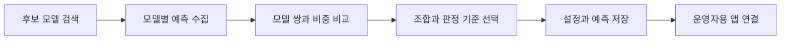
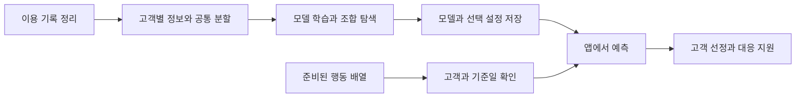

<div align="center">

# 음악 스트리밍 가입 고객 이탈 예측

### 이용 기록 기반 이탈 예측과 고객 대응 지원

최근 28일의 이용 기록으로 앞으로 14일 안에 해지할 가능성을 예측하고,<br>
운영자가 관리할 고객을 고르고 대응 방법을 정하도록 돕는 서비스입니다.

</div>

### 프로젝트 요약

음악 스트리밍 고객의 이용 기록을 분석해 해지 위험 고객을 사전에 식별하는 프로젝트입니다.<br>
예측 결과를 고객별 위험 신호, 대응 제안, 비용 기반 계획과 연결해 운영자용 앱으로 구현했습니다.

| 원본 이용 기록 | 분석 고객 | 예측할 내용 | 모델 입력 | 앱에 적용한 조합 |
|:---:|:---:|:---:|:---:|:---:|
| 26,259,199건 | 18,139명 | 이후 14일 안의 해지 완료 여부 | 고객별 정보 14개와 행동 순서 | 에이다부스트 60%와 장단기 기억 신경망 40% |

**핵심 개발 성과: 모델 조합·비중 탐색 코드 구현, 선택 결과 저장, 운영자용 앱 연동**

검증 고객 2,721명에서 실제 이탈 고객 156명 중 133명을 찾아냈습니다.<br>
**실제 이탈 고객을 찾아낸 비율인 재현율은 85.3%**입니다.<br>
다만 관리 대상으로 선정한 640명 중 실제 이탈 고객은 133명이었습니다.<br>
**선정한 고객 중 실제 이탈 고객의 비율인 정밀도는 20.8%**입니다.<br>
실제 운영에서는 이탈 고객 포착 비율과 대응 인원·비용을 함께 고려해야 합니다.

### 기술 스택

| 구분 | 기술 |
|---|---|
| 프론트엔드·대시보드 |     |
| 언어·데이터 처리 |    |
| 머신러닝 |      |
| 딥러닝 |     |
| 모델 저장·로딩 |  |
| 데이터 저장 |  |
| 버전 관리 |   |

> 최종 시연 앱은 AdaBoost 60%와 LSTM 40%의 모델 출력을 결합해 고객의 이탈 위험 점수를 계산합니다.

### 팀 소개와 역할 분담

| 이름 | 주요 수행 내용 |
|---|---|
| 김성환 | 공통 데이터 전처리·탐색 분석, 서비스 통합 및 발표 자료 정리 |
| 서민석 | 최근접 이웃·나이브 베이즈 등 정형 모델 실험 |
| 김신형 | 그래디언트 부스팅 모델 실험 및 앱 초기 구현 |
| 염진일 | 랜덤 포레스트 모델 실험 |
| 이재현 | 정형·시퀀스 모델 실험 및 모델 조합 탐색 코드 구현 |

### 발표 순서

| 순서 | 내용 |
|---|---|
| [1](#section-1) | 프로젝트 목표 |
| [2](#section-2) | 데이터와 이탈 정의 |
| [3](#section-3) | 데이터 전처리와 탐색 분석 |
| [4](#section-4) | 모델 학습과 성능 비교 |
| [5](#section-5) | 모델 조합 탐색 코드와 적용 결과 |
| [6](#section-6) | 운영자용 앱의 사용 흐름 |
| [7](#section-7) | 프로그램 구성과 실행 방법 |
| [8](#section-8) | 주요 성과와 한계 |
| [9](#section-9) | 제출 자료 |
| [10](#section-10) | 앱 시연 영상 |
| [13](#section-13) | 팀원별 프로젝트 회고 |

---

<a id="section-1"></a>

## 1. 프로젝트 목표

음악 스트리밍 고객이 서비스를 떠나기 전에, 운영자가 먼저 확인하고 대응할 수 있도록 돕는 것이 목표입니다.<br>
위험 점수와 이용 상황을 기준으로 대응 대상을 선정하도록 설계했습니다.

음악 이용 기록은 행동 종류와 시각을 함께 제공해 최근 이용 변화를 분석하기에 적합합니다.<br>
곡 재생·좋아요·광고 노출 등 다양한 행동으로 고객의 이용 특성과 최근 변화를 파악할 수 있습니다.<br>
또한 해지 화면에 방문한 기록과 실제로 해지를 완료한 기록을 구분할 수 있습니다.

이번 프로젝트는 **데이터 정리 → 여러 모델 비교 → 조합 탐색 코드 구현 → 운영자용 앱 적용**까지 연결했습니다.<br>
실제 연락이나 혜택 제공은 운영자가 결정하며, 앱이 자동으로 알림을 발송하지는 않습니다.

---

<a id="section-2"></a>

## 2. 데이터와 이탈 정의

원본은 음악 스트리밍 서비스에서 발생한 이용 기록 약 2,626만 건입니다.<br>
원본의 한 행은 곡 재생이나 화면 방문 같은 행동 한 건을 나타냅니다.<br>
행동 기록을 집계해 고객 한 명당 한 행인 분석 자료로 구성했습니다. 특정 실제 서비스의 운영 자료라고 단정하지는 않습니다.


예측 기준일은 2018년 11월 1일입니다.<br>
그전 28일의 행동을 입력으로 사용하고, 이후 14일 안에 해지를 완료했는지를 정답으로 정했습니다.<br>
과거 행동으로 이후 해지를 예측하기 위해 관찰 기간과 예측 기간을 분리했습니다.

| 구분 | 정한 기준 |
|---|---|
| 관찰 기간 | 2018년 10월 4일 00시 이상~11월 1일 00시 미만 |
| 예측 기간 | 2018년 11월 1일 00시 이상~11월 15일 00시 미만 |
| 시간 기준 | 협정 세계시 |
| 분석 대상 | 관찰 기간에 활동했고, 기준일 전에 해지하지 않은 고객 |
| 이탈 1 | 예측 기간 안에 해지 완료 기록이 있음 |
| 이탈 0 | 예측 기간 안에 해지 완료 기록이 확인되지 않음 |

최종 분석 고객은 **18,139명**, 그중 이탈 고객은 **1,035명으로 약 5.71%**였습니다.<br>
이탈 0은 이 기간에 해지가 확인되지 않았다는 뜻이며, 이후에도 계속 이용한다는 보장은 아닙니다.

---

<a id="section-3"></a>

## 3. 데이터 전처리와 탐색 분석

### 결측값과 이상 기록 처리

결측값은 발생 상황을 확인한 뒤 처리 기준을 정했습니다.<br>
홈 화면 방문의 곡 정보 누락은 정상적인 기록으로 보존하고,<br>
실제 곡 재생 기록의 곡 정보 누락 여부는 별도로 검사했습니다.

| 확인한 내용 | 처리한 방법과 이유 |
|---|---|
| 비로그인·방문자 기록이 공통 고객 번호 하나에 모임 | 가입 고객 한 사람으로 볼 수 없어 해당 번호의 778,479건 제외 |
| 일부 기록에 곡 정보가 없음 | 곡을 재생하지 않은 행동에서 생긴 누락은 보존. 재생 기록에는 곡 정보가 있음을 확인 |
| 144명에게 가입 시각보다 앞선 행동 11,484건이 있음 | 가입 기간을 계산한 입력 항목은 제외하고 행동 기록은 보존 |
| 이용량이 아주 크거나 행동 횟수가 0임 | 오류라는 근거가 없어 임의 삭제하지 않음. 음수인 이용 변화도 감소를 뜻하므로 보존 |
| 고객표 저장과 분할 | 자료형·빈값·범위·고객 중복·계산식·저장 전후 일치를 검사 |

이 기준을 적용한 관찰 활동 고객 20,642명 중 기준일 이전 해지 고객 2,503명을 제외했습니다.<br>
그 결과 분석 대상 18,139명을 확정했습니다.

### 입력 변수 구성

고객마다 이용 규모, 최근 변화, 만족·불편 신호, 이용 등급을 모아 **숫자 항목 13개와 이용 등급 1개**를 만들었습니다.

| 구분 | 입력 정보 |
|---|---|
| 이용 규모 | 활동 일수, 접속 묶음인 세션 수, 곡 재생 수 |
| 최근 이용 변화 | 마지막 활동 이후 지난 일수, 최근 7일과 이전 7일 재생 수, 두 기간의 차이 |
| 고객 반응 | 좋아요·싫어요·재생목록 추가·광고·오류·도움말 횟수 |
| 이용 등급 | 관찰 기간 마지막 무료·유료 상태 |

고객 번호와 이탈 정답은 모델 입력에서 제외했습니다.<br>
행동 순서를 분석하는 신경망에는 최근 최대 50개 행동을 사용했습니다.<br>
행동 이름을 숫자로 변환하고, 50개 미만이면 뒤쪽을 0으로 채웠습니다.<br>
숫자 변환 규칙은 [시퀀스 생성 코드](notebooks/시퀸스데이터.ipynb)에서 확인했으며,<br>
입력 자료의 기간 제한은 팀의 전제로 적용했습니다.<br>
원본 날짜 범위를 다시 검사한 결과로 표현하지는 않았습니다.

### 이용 등급·변화와 이탈의 관계

분석은 학습 고객 12,697명만 사용했습니다.<br>
요금제와 최근 이용 변화에 따른 이탈 비율을 비교했습니다.


유료 고객의 이탈 비율은 7.14%, 무료 고객은 4.07%였습니다.<br>
최근 재생 수가 증가한 고객도 이탈 비율이 6.30%로, 감소한 고객의 5.83%보다 높았습니다.<br>
**이용량 감소만으로 이탈 고객을 판단하기 어렵다는 점**을 확인했습니다.

### 최근 활동·이용 규모와 이탈의 관계


마지막 활동이 하루도 지나지 않은 고객도 이탈 비율은 8.76%였습니다.<br>
관찰 기간에 1,000회 이상 재생한 고객의 이탈 비율은 12.12%였습니다.<br>
**최근 활동이 많아도 이탈할 수 있으므로 여러 행동 정보를 함께 고려할 필요가 있습니다.**

활동 일수와 세션 수는 함께 움직이는 정도가 약 0.975로 높았습니다.<br>
비슷한 정보를 담은 입력이 있다는 뜻이므로, 각 항목을 서로 독립적인 해지 원인이라고 해석하지 않았습니다.<br>
이 분석은 행동과 이탈이 함께 나타난 관계를 살펴본 것이며, 그 행동을 바꾸면 이탈이 줄어든다는 증거는 아닙니다.

[자세한 분석과 그래프 6개](docs/03_탐색적데이터분석.md) · [분석 실행 노트북](notebooks/05_탐색적데이터분석.ipynb)

---

<a id="section-4"></a>

## 4. 모델 학습과 성능 비교

### 데이터 분할과 평가 지표


이탈 고객의 비율은 약 6%로 적습니다.<br>
검증 고객을 모두 유지 고객이라고 예측해도 정확도는 약 94.27%가 됩니다.<br>
이탈 고객을 찾지 못해도 높은 정확도가 나올 수 있어, 여러 평가 지표를 함께 사용했습니다.

| 지표 | 평가 의미 |
|---|---|
| 평균정밀도 | 위험 순위의 앞쪽에 실제 이탈 고객을 얼마나 잘 모았는지 요약 |
| 수신자 곡선 면적 | 실제 이탈 고객에게 유지 고객보다 높은 점수를 주는지 평가 |
| 정밀도 | 이탈할 것으로 선정한 고객 중 실제 이탈 고객의 비율 |
| 재현율 | 실제 이탈 고객 중 모델이 찾아낸 고객의 비율 |
| 조화평균 | 정밀도와 재현율을 함께 고려하는 값 |

팀원들이 같은 고객으로 비교하도록 공통 분할표를 사용했습니다.<br>
학습 자료로 모델을 학습하고, 검증 자료로 모델 설정과 이탈 판정 기준을 비교했습니다.

| 구분 | 고객 수 | 이탈 고객 수 |
|---|---:|---:|
| 학습 | 12,697 | 724 |
| 검증 | 2,721 | 156 |
| 최종 평가용으로 분리한 자료 | 2,721 | 155 |

### 기준 모델 3종의 비교

먼저 같은 검증 고객 2,721명에서 로지스틱 회귀, 서포트 벡터 머신, 다층 신경망을 비교했습니다.<br>
모델 설정은 평균정밀도를 기준으로, 이탈 판정 기준은 정밀도와 재현율의 조화평균을 기준으로 선택했습니다.

| 모델 | 평균정밀도 | 수신자 곡선 면적 | 정밀도 | 재현율 | 조화평균 |
|---|---:|---:|---:|---:|---:|
| 로지스틱 회귀 | 0.1701 | 0.7074 | 24.26% | 21.15% | 0.2260 |
| 서포트 벡터 머신 | 0.1658 | 0.7115 | 19.72% | 26.92% | 0.2276 |
| 다층 신경망 | 0.1773 | 0.7053 | 22.29% | 23.72% | 0.2298 |


세 모델 중 평균정밀도는 다층 신경망이 가장 높았습니다.<br>
재현율은 서포트 벡터 머신이 가장 높았습니다.<br>
모델 간 차이가 작고 지표별 우열이 달라, 한 지표만으로 최우수 모델을 단정하지 않았습니다.

### 과적합 점검과 설정 조정

학습 자료에는 잘 맞지만 다른 자료에서 성능이 떨어지는 현상을 과적합이라고 합니다.<br>
이를 확인하기 위해 학습 성능과 검증 성능을 함께 비교하고 모델 설정을 조정했습니다.

| 모델 | 확인한 문제와 조정 |
|---|---|
| 로지스틱 회귀 | 모델이 복잡해지는 정도를 제한하는 설정과 이탈 고객에 주는 가중치를 비교. 평균정밀도 개선은 작았음 |
| 서포트 벡터 머신 | 기본 모델의 학습 평균정밀도 0.5152에 비해 검증은 0.1038로 낮았음. 설정 조정 후 학습 0.1384·검증 0.1658로 차이를 줄임 |
| 다층 신경망 | 학습 회차마다 검증 성능을 확인하고, 가장 좋았던 회차의 모델을 보존 |


학습 평균정밀도는 상승했으나 검증 평균정밀도는 2회차 이후 하락했습니다.<br>
검증 성능을 기준으로 **2회차 모델**을 복원했습니다.<br>
검증 성능이 15회 연속 좋아지지 않아 17회차에서 학습을 종료했습니다.

판정 기준을 낮추면 관리 대상으로 선정되는 고객 수가 증가합니다.<br>
다만 대상 수가 바뀌는 것과 모델의 순위 평가 지표가 좋아지는 것은 구분했습니다.

<details>
<summary>팀 확장 실험의 후보 16종과 저장 결과 보기</summary>

정형 입력 13종과 시퀀스 입력 3종입니다. 정형 후보에도 다층 신경망이 포함되므로 모두 비신경망 모델이라고 부르지 않습니다.
아래 수치는 최종 평가용 자료를 탐색에 사용한 참고값으로, 앞의 세 모델 검증 성능과 합쳐 순위를 정하지 않습니다.

| 후보 | 입력 | 저장 수신자 곡선 면적 | 저장 판정 기준 |
| --- | --- | --- | --- |
| 에이다부스트 | 정형 | 0.7292 | 0.337763 |
| 결정 트리 | 정형 | 0.6880 | 0.067890 |
| 엑스트라 트리 | 정형 | 0.7264 | 0.064205 |
| 히스토그램 그래디언트 부스팅 | 정형 | 0.7216 | 0.055802 |
| 최근접 이웃 | 정형 | 0.5990 | 0.200000 |
| 라이트지비엠 | 정형 | 0.7373 | 0.061214 |
| 로지스틱 회귀 | 정형 | 0.7226 | 0.049297 |
| 정형 다층 신경망 | 정형 | 0.5882 | 0.029583 |
| 나이브 베이즈 | 정형 | 0.6966 | 0.000607 |
| 랜덤 포레스트 | 정형 | 0.7259 | 0.060549 |
| 서포트 벡터 머신 | 정형 | 0.4927 | 0.034101 |
| 엑스지부스트 | 정형 | 0.7331 | 0.058718 |
| 캐트부스트 | 정형 | 0.7337 | 0.082539 |
| 일차원 합성곱 신경망 | 시퀀스 | 0.8453 | 0.383324 |
| 장단기 기억 신경망 | 시퀀스 | 0.8685 | 0.505169 |
| 트랜스포머 | 시퀀스 | 0.8631 | 0.415613 |

</details>

---

<a id="section-5"></a>

## 5. 모델 조합 탐색 코드와 적용 결과

### 모델 조합 탐색 코드 구현

고객별 집계표를 사용하는 모델 13종과 행동 순서를 분석하는 신경망 3종을 실험했습니다.<br>
서로 다른 입력 정보의 결합 가능성을 확인하기 위해 개별 모델과 모델 조합을 비교했습니다.

이를 위해 **저장 모델 검색·예측 수집·모델 쌍과 결합 비중 비교를 수행하는 탐색 코드**를 구현했습니다.<br>
정형 모델 13개와 신경망 3개에 비중 10가지를 적용해 **390개 조합**을 비교했습니다.

| 단계 | 구현 기능 |
|---|---|
| 1. 후보 모델 검색 | 모델 폴더에서 지원하는 저장 파일을 찾음 |
| 2. 예측값 수집 | 각 모델로 같은 고객을 예측하고 결과를 모음 |
| 3. 조합·비중 비교 | 정형 모델 비중을 50%부터 95%까지 5%씩 바꾸며 신경망과 결합 |
| 4. 조합 선택 | 수신자 곡선 면적이 가장 높은 조합을 선택 |
| 5. 판정 기준 선택 | 정밀도와 재현율 중 재현율을 더 중시하는 기준으로 이탈 판정값 선택 |
| 6. 결과 저장 | 선택한 모델 이름·비중·판정 기준과 예측 결과를 파일로 저장 |
| 7. 앱 연동 | 저장된 결과를 앱에서 불러오고 같은 예측이 나오는지 확인 |



**탐색 코드를 구현하고 선택 결과를 앱에 연결한 것이 이번 프로젝트의 주요 개발 성과입니다.**<br>
다만 정해 둔 후보와 비중 안에서 고른 결과이며, 가능한 모든 모델 중 최적임을 증명한 것은 아닙니다.

[탐색 코드](notebooks/최적_모델_탐색.ipynb) · [저장한 조합 설정](model/best_hybrid_config.json)

### 선택한 모델 조합

선택한 조합은 **에이다부스트 60%와 장단기 기억 신경망 40%**입니다.<br>
두 모델의 예측값을 해당 비중으로 결합한 뒤 100을 곱해 위험 점수로 표시합니다.<br>
저장된 판정 기준은 약 0.398227이고, 화면에서는 **약 39.8점 이상**을 관리 대상으로 분류합니다.<br>
이 점수가 실제 해지율과 일치하도록 보정됐는지는 확인하지 않았으므로, 39.8점을 실제 해지 확률 39.8%라고 해석하지 않습니다.

### 적용 결과와 해석

| 검증 고객 2,721명에서 확인한 내용 | 인원 |
|---|---:|
| 실제 이탈 고객 | 156명 |
| 그중 모델이 찾아낸 고객 | 133명 |
| 놓친 이탈 고객 | 23명 |
| 관리 대상으로 선정한 전체 고객 | 640명 |
| 선정됐지만 실제로는 유지한 고객 | 507명 |

실제 이탈 고객 156명 중 133명을 찾았으므로 **재현율은 약 85.3%**입니다.<br>
반면 선정한 640명 중 실제 이탈 고객은 133명이므로 **정밀도는 약 20.8%**입니다.<br>
이탈 고객을 많이 찾아내는 대신 유지 고객도 많이 포함되기 때문에, 운영자는 예산과 관리 가능 인원에 맞춰 대상을 정해야 합니다.

| 결과 구분 | 평균정밀도 | 수신자 곡선 면적 |
|---|---:|---:|
| 저장 조합을 검증 자료에 연결해 확인한 결과 | 0.2968 | 0.8989 |
| 최종 평가용 자료로 조합을 탐색한 참고값 | 별도 제시하지 않음 | 0.8994 |

**위 수치는 모델 선택에 사용하지 않은 별도 자료에서 확인한 최종 성능은 아닙니다.**<br>
조합을 고를 때 최종 평가용 자료를 사용했기 때문에, 새로운 자료에서도 같은 성능이 나오는지는 추가 평가가 필요합니다.<br>
또한 앞의 기준 모델과는 입력과 선택 과정이 달라, 수치 차이를 모두 조합의 효과라고 설명하지 않았습니다.

---

<a id="section-6"></a>

## 6. 운영자용 앱의 사용 흐름

앱은 **관리 대상 선정·고객별 대응 제안·비용 계획**을 지원하도록 구성했습니다.<br>
관리 목록에서 시작해 고객 상세를 확인하고, 캠페인 계획과 결과 기록으로 이어집니다.

### 관리 대상 선정

[](assets/demo/01_home.mp4)

운영자는 점수 구간, 판정 기준, 관리 인원 또는 예산을 기준으로 고객을 고릅니다.<br>
요금제로 고객을 걸러 보고, 구간별 고객 수와 혜택 제안을 확인할 수 있습니다.<br>
구간별 알림 버튼은 화면에서 동작을 보여주는 모의 실행이며 실제 알림을 보내지는 않습니다.

### 고객별 위험 신호와 추천 대응

[](assets/demo/02_customer.mp4)

고객별 위험 점수, 두 모델의 점수, 주요 행동 신호와 추천 대응을 제공합니다.<br>
싫어요가 많은 고객에게는 취향 재설정과 맞춤 재생목록을 제안합니다.<br>
추천 대응은 고객의 실제 불편을 확인하기 위한 참고 정보이며, 확정된 해지 원인은 아닙니다.

### 비용 기반 대응 계획

캠페인 화면에는 고객을 유지했을 때의 가치, 연락·혜택 비용, 가정한 성공률을 입력합니다.<br>
이 값을 바탕으로 연락 인원과 예상 손익을 비교합니다.<br>
화면의 예상 이익은 입력한 가정에 따른 계산이며 실제로 얻은 수익은 아닙니다.

<details>
<summary>캠페인·고객 자료·설정 화면 보기</summary>

**캠페인 계획**

[](assets/demo/03_campaign.mp4)

**고객 자료 등록과 관리**

[](assets/demo/04_data.mp4)

**최적 조합의 연결 상태와 설정**

[](assets/demo/05_settings.mp4)

</details>

### 대응 결과 기록

홈의 대응 결과 확인에서는 대응한 집단과 비교 집단의 고객 수, 이탈 수, 비용을 기록할 수 있습니다.<br>
실제 효과를 확인하려면 비슷한 대상에서 대응 여부를 무작위로 나누고 같은 14일을 관찰해야 합니다.<br>
**현재는 고객 선정과 대응 지원 기능을 구현한 단계이며, 실제 대응으로 이탈이 감소했는지는 측정하지 않았습니다.**

<details>
<summary>위험 점수 구간과 제안 혜택의 자세한 기준</summary>

| 기본 구간 | 화면의 혜택 제안 예시 |
|---|---|
| 90점 이상 100점 이하 | 1개월 무료 또는 3개월간 월 990원 |
| 80점 이상 90점 미만 | 3개월 연속 50% 할인 또는 1개월 무료 연장 |
| 70점 이상 80점 미만 | 2~3개월간 30~40% 할인과 맞춤 재생목록 |
| 50점 이상 70점 미만 | 1~2개월간 15~20% 할인 쿠폰 또는 포인트 |
| 30점 이상 50점 미만 | 다운로드·고음질·제휴 콘텐츠 이용 혜택 |
| 0점 이상 30점 미만 | 일반 멤버십 유지, 구간별 알림 모의 실행에서 제외 |

구간과 혜택은 운영 예시이며 비용·효과를 검증해 고른 최적 정책이 아닙니다.<br>
모델의 약 39.8점 판정 기준과 운영 구간 기준은 서로 다릅니다.<br>
구간 관리 모드의 전체 내려받기 목록에는 선택한 요금제의 저위험군도 포함됩니다.<br>
고객 상세의 행동 영향은 행동 순서를 고정하고 고객별 집계값만 바꿔 비교한 값이며 실제 대응 효과가 아닙니다.

</details>

---

<a id="section-7"></a>

## 7. 프로그램 구성과 실행 방법

학습 코드와 앱 실행 코드를 분리했습니다.<br>
모델은 먼저 학습해 저장하고, 앱에서는 저장된 모델을 불러와 예측합니다.<br>
화면·예측·입력 검사·기록 저장을 기능별로 분리해 유지보수가 가능하도록 구성했습니다.



새 자료를 넣을 때는 고객 번호, 값의 범위, 계산식과 기준일을 검사합니다.<br>
현재 앱은 준비된 행동 배열을 사용합니다. 신규 원시 로그를 올리면 자동으로 행동 배열까지 만들어 주는 기능은 연결하지 않았습니다.

<details>
<summary>주요 파일과 실행 명령</summary>

| 역할 | 파일 |
|---|---|
| 화면과 디자인 | `service/app.py`, `service/ui.py` |
| 모델 불러오기와 예측 결합 | `service/core.py`, `models.py` |
| 행동 배열 연결과 검사 | `service/sequence_runtime.py` |
| 고객 자료 검사와 보관 | `service/validation.py`, `service/storage.py` |
| 대응 결과 입력과 저장 | `service/operating_views.py`, `service/operations.py` |

파이썬 3.12 환경에서 저장소 최상위 폴더를 열고 실행합니다.

```powershell
python -m pip install -r requirements.txt
python -m streamlit run service/app.py
```

앱 시작 시 다시 학습하지 않습니다.<br>
원본 약 12기가바이트와 실제 운영 중 생긴 고객·대응 기록은 제출 자료에 포함하지 않았습니다.

</details>

---

<a id="section-8"></a>

## 8. 주요 성과와 한계

이번 프로젝트에서는 대규모 이용 기록을 고객별 학습 자료로 정리하고, 모델 비교와 조합 탐색 코드를 구현했습니다.<br>
그 결과를 운영자가 사용할 수 있는 앱으로 연결했으며, 고객 선정부터 대응 계획과 결과 기록까지 준비했습니다.

| 완성한 내용 | 확인한 결과 |
|---|---|
| 고객별 학습 자료 | 18,139명, 입력 항목 14개, 고객 중복 없는 공통 분할 |
| 데이터 분석 | 학습 자료 대상 그래프 6개와 처리 이유 기록 |
| 모델 비교 | 기준 모델 3종과 팀 확장 후보의 실험 기록 |
| 조합 탐색 코드 | 390개 조합 비교, 판정 기준 선택, 설정·예측 저장 |
| 운영자용 앱 | 고객 선정·상세·계획·결과 기록, 기존 기능 검사 20개 통과 |

추가 검증이 필요한 범위는 다음과 같습니다.<br>
모델 선택에 쓰지 않은 새로운 자료에서 다시 평가하고, 실제 대응을 했을 때 이탈이 줄어드는지도 확인해야 합니다.<br>
행동 배열의 생성 규칙은 확인했지만 입력 기간 제한은 팀의 전제로 사용했으며, 원본 날짜를 다시 검사하거나 배열 전체를 재생성해 비교하지는 않았습니다.

**주요 성과는 모델 조합 탐색 코드 구현과 예측 결과의 운영자 대응 기능 연결입니다.**<br>
실제 이탈 감소와 수익 개선은 이후 운영 결과로 검증할 과제입니다.

---

<a id="section-9"></a>

## 9. 제출 자료

전처리·학습 결과서와 분석·학습 코드에 수행 과정과 선택 근거를 기록했습니다.<br>
학습된 모델과 앱 실행에 필요한 자료도 함께 제출했습니다.

| 자료 | 확인할 내용 |
|---|---|
| [데이터 전처리 결과서](docs/01_데이터전처리_결과서.md) | 빈값·이상값 처리, 입력 항목, 분할과 변환 기준 |
| [학습 결과서](docs/02_학습_결과서.md) | 모델 비교, 설정 조정, 과적합 점검, 조합 선택 근거 |
| [탐색 분석](docs/03_탐색적데이터분석.md) | 데이터 분포와 주요 행동·이탈의 관계 |
| [전처리 코드](notebooks/01_데이터검증_및_전처리.ipynb)와 [분석 코드](notebooks/05_탐색적데이터분석.ipynb) | 검사와 분석 과정 |
| [조합 탐색 코드](notebooks/최적_모델_탐색.ipynb) | 모델 쌍·비중 비교와 결과 저장 |
| [행동 배열 생성 코드](notebooks/시퀸스데이터.ipynb) | 행동을 숫자로 바꾸고 길이를 맞추는 방법 |
| `model/`, `models.py` | 앱에서 사용하는 모델·선택 설정·신경망 구조 |
| `service/`, `data/processed/`, `assets/` | 앱 코드·처리 자료·발표 그래프와 시연 영상 |

탐색 노트북은 당시 실험 기록입니다.<br>
제출한 모델은 앱 실행용입니다.<br>
**390개 조합 전체의 재실행에는 당시 후보 모델 전체, 동일한 입력 변환 자료와 경로 설정이 필요**합니다.

---

<a id="section-10"></a>

## 10. 앱 시연 영상

**[전체 시연 영상 파일 내려받기](https://raw.githubusercontent.com/SKNETWORKS-FAMILY-AICAMP/SKN37-2ST-4TEAM/main/assets/demo/00_full_demo.mp4)** · 약 2분 28초 · 관리 목록 → 고객 상세 → 캠페인 → 고객 자료 → 설정 순서

아래 움직이는 이미지는 각 영상의 일부를 보여주는 짧은 미리보기입니다. 소리는 없으며, 전체 길이와 녹화된 소리는 영상 파일에 포함됩니다. 전체 영상은 내려받아 재생합니다.

### 관리 목록 미리보기


<details>
<summary>고객 상세·캠페인·고객 자료·설정 미리보기 펼치기</summary>

**고객 상세**


**캠페인**


**고객 자료**


**설정과 분석 자료**


</details>

| 개별 시연 영상 | 길이 | 영상 파일 |
|---|---|---|
| 관리 목록 | 약 24초 | [내려받기](https://raw.githubusercontent.com/SKNETWORKS-FAMILY-AICAMP/SKN37-2ST-4TEAM/main/assets/demo/01_home.mp4) |
| 고객 상세 | 약 35초 | [내려받기](https://raw.githubusercontent.com/SKNETWORKS-FAMILY-AICAMP/SKN37-2ST-4TEAM/main/assets/demo/02_customer.mp4) |
| 캠페인 계획 | 약 37초 | [내려받기](https://raw.githubusercontent.com/SKNETWORKS-FAMILY-AICAMP/SKN37-2ST-4TEAM/main/assets/demo/03_campaign.mp4) |
| 고객 자료 | 약 31초 | [내려받기](https://raw.githubusercontent.com/SKNETWORKS-FAMILY-AICAMP/SKN37-2ST-4TEAM/main/assets/demo/04_data.mp4) |
| 설정과 분석 자료 | 약 21초 | [내려받기](https://raw.githubusercontent.com/SKNETWORKS-FAMILY-AICAMP/SKN37-2ST-4TEAM/main/assets/demo/05_settings.mp4) |

시연은 예측·고객 선정·대응 계획 기능의 동작을 보여줍니다. 실제 알림 발송이나 이탈 감소 성과를 뜻하지 않습니다.

---

<a id="section-13"></a>

## 13 팀원별 프로젝트 회고


> **이재현**
> 이번에 개인적으로 욕심을 부려서 조금이라도 난이도 있는 프로젝트를 하고 싶었습니다. 다만 구할 수 있는 데이터가 12.76GB 정도였고, 분석해본 결과 많이 쳐줘도 최근 50개 정도, 실질적으로는 최근 5개 정도의 행동만으로 딥러닝을 하는 결과를 보였습니다. 이 점을 고려하여 유저가 방문한 마지막 페이지를 정형 데이터 피처로 입력하여 머신러닝을 하면 딥러닝과 블렌딩하는 것보다 더 성능이 높게 나왔습니다.
> 
> 이러한 점을 보았을 때 딥러닝은 데이터 규모가 정말 어마어마하게 커야 하고, 시간을 많이 투자해야 한다는 점을 느꼈으며, 이 정도의 데이터는 피처 엔지니어링과 머신러닝으로 충분히 커버 가능하다는 점, 그리고 딥러닝이 강세라고는 하지만 머신러닝도 특정 분야에서는 강점을 가진다는 점을 느꼈습니다.
> 
> 힘들었던 점 및 트러블슈팅:
> 1. 데이터가 커서 기존에 배웠던 방법으로 처리가 안 되어 방법을 찾아내고 적용하는 게 힘들었습니다.
> 2. 모델링을 각자 해서 모은 모델들 중 최적의 조합을 찾아서 블렌딩하였는데, 딥러닝은 혼자 담당해서 괜찮았지만 머신러닝 모델들은 이상하게 안 맞아서 그걸 수정하는 것이 힘들었습니다. 대표적으로 CatBoost는 혼자 저장 형식이 `.cbm`이라서 처리하기 귀찮았습니다.
> 3. 알고는 있었지만 작업 시작 전 확실하게 정해두고 시작해야 한다는 점을 좀 더 크게 느꼈습니다. 초반에 데이터 전처리한 것을 바꿨었는데, 바꾸고 나서 딥러닝 성능이 급감하거나 데이터가 안 맞는 등 문제가 발생해서 이를 처리해내는 것이 다소 힘들었습니다.
> 4. 피처 엔지니어링이 다소 까다로웠습니다. 데이터 성격상 이탈 고객의 범주를 우리가 정하는 것이 아닌 데이터에서 이탈 여부를 파악할 수 있지만 그걸 처리하는 것이 까다로웠습니다. 이를 잘못 처리해서 딥러닝과 머신러닝 테스트 데이터로 답을 100% 맞추는 기염을 토했으나, 다행히 데이터 누수(Data Leakage)되는 부분을 찾아 수정한 후 정상 범주로 돌아오는 경험을 하였습니다.

> **서민석**
> 1. 배운 점 및 성장한 부분
> - 데이터 전처리의 중요성 재발견: 단순한 불필요 컬럼 제거(drop) 수준을 넘어, 데이터 특성에 맞춰 맞춤형 전처리를 진행할 때 학습 효율과 정확도가 크게 상승하고 학습 시간도 단축됨을 확인했습니다.
> - 다양한 모델의 실전 적용 및 앙상블 활용: 이론으로 배운 k-NN, Naive Bayes 등 머신러닝 알고리즘과 LSTM, GNN 등 딥러닝 모델을 직접 구현했습니다. 머신러닝과 딥러닝의 장점을 결합한 앙상블 기법을 적용하여 모델 간 단점을 보완하고 예측 성능을 개선했습니다.
> 
> 2. 트러블슈팅 (문제 해결 경험)
> - 문제 상황: 초기에 대용량 데이터로 정확도, 재현율, F2-Score 등을 확보했으나, 프로젝트 취지에 맞게 데이터를 압축/정제하면서 데이터 수가 줄어들어 모델 성능이 하락하는 어려움을 겪었습니다.
> - 해결 방안: 데이터 재분할 전략을 도입하고, 데이터 특성에 맞는 새로운 모델을 도입 및 튜닝하여 성능을 다시 끌어올렸습니다.

> **김신형**
> 이번 프로젝트에서 나는 그래디언트 부스팅 모델링, 이탈 관리 서비스(Streamlit) 제작을 맡았다.
> 
> 가장 크게 배운 건 "좋은 점수"와 "쓸 수 있는 결과"가 다르다는 점이다. 이탈 고객이 5.7%뿐이라 모든 고객을 유지로 찍어도 정확도가 94%가 나온다. 그래서 재현율과 정밀도, 그리고 관리할 수 있는 인원 안에서 실제 이탈자를 몇 명 찾는지를 기준으로 삼았다. XGBoost, LightGBM, CatBoost는 ROC-AUC 0.74 근처로 큰 차이가 없었고, 오히려 그 점수를 운영자가 이해하고 바로 쓸 수 있게 만드는 일(위험 점수, 판정 기준, 캠페인 손익 계산, 대응 효과 확인)에 더 많은 고민이 들어갔다.
> 
> 어려웠던 점 및 트러블슈팅:
> - 점수 눈금 맞추기: 모델마다 확률 크기가 달라 머신러닝과 신경망 점수를 그대로 섞을 수 없었다. 검증 고객 안에서의 순위로 바꾼 0~100점 위험 점수를 만들어 해결했다.
> - GitHub 협업: 웹 업로드에 의존하다 보니 `.streamlit`, `.gitignore`처럼 점으로 시작하는 파일이 빠지거나, 실행에 필요한 파일이 빠져 일일이 수기로 입력해야 하는 상황이 발생했었다.
> - 마지막 통합: 최종 통합 앱의 수정이 너무 여러 사람이 진행되어 내가 수정한 내용이 다른 사람에 의해 덮어쓰기 되어버리는 바람에 다시 작업을 해야하는 경우가 여러번 있었다.

> **염진일**
> 이번 프로젝트를 통해 AI 기술이 가져오는 혁신과 영향력을 새삼 실감하였으며, 향후 AI를 효과적으로 다루고 활용하는 역량이 핵심 경쟁력이 될 것임을 깨달았다. 실제 앱 테스트와 문서 검토 과정을 거치며 이론으로만 배웠던 머신러닝과 딥러닝의 개념을 깊이 있게 체득할 수 있었다. 이번에 쌓은 실무적 감각을 바탕으로, 앞으로 AI를 적극적으로 융합하도록 해야 할 것이다.

> **김성환**
> 이번 프로젝트에서는 공통 데이터 전처리와 탐색 분석, 서비스 통합, 발표 자료 정리를 맡았습니다. 가장 크게 배운 점은 데이터를 정리하는 일이 단순히 빈값을 채우거나 필요 없는 열을 지우는 작업이 아니라는 것입니다. 약 12기가바이트의 이용 기록을 확인하면서, 같은 누락이라도 행동의 종류에 따라 의미가 다르고 고객 번호가 있다고 모두 한 사람의 기록으로 볼 수는 없다는 점을 배웠습니다. 어떤 값을 제외하고 어떤 값을 남겼는지 설명할 수 있는 기준을 만드는 것이 중요했습니다.
>
> 팀원들이 함께 사용할 고객표와 분할 기준을 정리하면서, 협업에서는 입력 항목과 자료 형식을 먼저 맞추는 일이 중요하다는 것도 느꼈습니다. 개별 결과를 모으는 것만으로는 하나의 서비스가 완성되지 않았고, 모델 입력과 화면 설명, 자료의 버전을 일치시키는 과정이 필요했습니다.
>
> 서비스와 발표 자료를 정리할 때는 개발자가 이해하는 표현을 운영자와 발표를 듣는 사람이 이해할 수 있는 말로 바꾸는 데 고민이 많았습니다. 앞으로는 공통 데이터 기준과 파일 관리 방식을 초반에 정하고, 분석 결과가 실제 사용자의 판단에 어떻게 도움이 되는지까지 고려하며 프로젝트를 진행하고 싶습니다.

