<div align="center">

# 음악 스트리밍 가입 고객 이탈 예측

### 행동 로그에서 대응 우선순위까지

최근 28일의 이용 기록으로 향후 14일 해지를 예측하고,<br>
운영자가 고객을 선정하고 대응을 계획하도록 돕는 서비스입니다.

</div>

### 한눈에 보기

| 원본 로그 | 분석 고객 | 이탈 정의 | 모델 입력 | 앱 적용 조합 |
|:---:|:---:|:---:|:---:|:---:|
| 26,259,199건 | 18,139명 | 이후 14일의 해지 완료 | 정형 피처 14개와 행동 시퀀스 | 에이다부스트 60%와 장단기 기억 신경망 40% |

**주요 개발 성과:** 모델 조합·비중 탐색 코드 구현 → 선택 결과 저장과 예측 재현 → 운영자용 앱 적용.

**운영 흐름:** 고객 선정 → 확인 신호와 대응 제안 → 비용 기반 계획 → 대응 결과 기록.

검증 연결 점검에서 이탈 고객 156명 중 133명을 찾았고, 선정한 640명 중 실제 이탈 고객은 133명이었습니다. **이는 연결 점검 결과이며 독립적인 최종 성능이나 실제 이탈 방지 성과가 아닙니다.**

작성 기준: 2026년 11월 2일. 앱 화면은 팀에서 촬영한 실제 시연 영상에서 추출했습니다.

### 기술 스택

| 구분 | 기술 |
|---|---|
| 프론트엔드·대시보드 |     |
| 언어·데이터 처리 |    |
| 머신러닝 |      |
| 딥러닝 |     |
| 모델 저장·로딩 |  |
| 데이터 저장 |  |
| 버전 관리 |   |


### 팀 소개와 역할 분담

| 이름 | 주요 수행 내용 |
|---|---|
| 김성환 | 공통 데이터 전처리·탐색 분석, 서비스 통합 및 발표 자료 정리 |
| 서민석 | 최근접 이웃·나이브 베이즈 등 정형 모델 실험 |
| 김신형 | 그래디언트 부스팅 모델 실험 및 앱 초기 구현 |
| 염진일 | 랜덤 포레스트 모델 실험 |
| 이재현 | 정형·시퀀스 모델 실험 및 모델 조합 탐색 코드 구현 |

### 발표 순서

| 순서 | 내용 | 발표에서 전달할 질문 |
|---|---|---|
| [1](#section-1) | 프로젝트 개요 | 왜 음악 로그를 선택했는가? |
| [2](#section-2) | 데이터와 문제 정의 | 누구의 어떤 이탈을 예측하는가? |
| [3](#section-3) | 전처리와 탐색 분석 | 무엇을 확인하고 어떻게 처리했는가? |
| [4](#section-4) | 학습과 평가 | 같은 조건에서 어떻게 비교했는가? |
| [5](#section-5) | 모델 조합 탐색 구현과 적용 | 어떤 탐색 코드를 만들고 결과를 어떻게 연결했는가? |
| [6](#section-6) | 서비스 구현 | 운영자가 예측을 어떻게 사용하는가? |
| [7](#section-7) | 구조와 실행 | 기능을 어떻게 나누고 재현하는가? |
| [8](#section-8) | 결과와 한계 | 완료한 것과 남은 것은 무엇인가? |
| [9](#section-9) | 산출물과 평가 항목 | 평가 근거는 어디에 있는가? |
| [10](#section-10) | 앱 시연 영상 | 앱 실행 없이 기능을 어떻게 확인하는가? |

---

<a id="section-1"></a>

## 1. 프로젝트 개요

모델의 예측을 연락 대상 선정과 고객별 대응에 활용하는 것이 목적입니다. 추천 대응을 실제로 제공했을 때 이탈이 줄어드는지는 별도로 확인합니다.

- 예측 대상은 향후 14일 안의 해지 완료 여부입니다.
- 운영자는 위험 고객을 확인하고 불편 신호에 맞는 대응을 선택합니다.
- 실제 연락과 혜택은 운영자가 수행하며 앱에서 자동 발송하지 않습니다.
- 현재 앱은 대응 대상 선정과 제안, 캠페인 계획, 실제 결과의 수동 기록을 지원합니다.

### 왜 음악 스트리밍 로그인가

| 선택 근거 | 이번 설계에 반영한 내용 |
|---|---|
| 실제 해지 행동을 구분할 수 있음 | 해지 화면 방문 대신 해지 완료 이벤트를 정답으로 사용 |
| 행동에 시간이 기록됨 | 관찰 28일과 예측 14일을 분리하고 최근 7일의 변화도 집계 |
| 집계와 행동 순서를 함께 다룰 수 있음 | 고객별 정형 피처와 시퀀스 신경망의 서로 다른 입력을 준비 |
| 운영자의 대응과 연결하기 쉬움 | 고객 선정·불편 확인·혜택 제안·비용 계획으로 연결 |

차별점은 **대규모 로그의 품질 검사, 모델 조합·비중 탐색 코드 구현, 저장한 탐색 결과의 운영자용 앱 연결**을 하나의 흐름으로 수행한 점입니다. 제공된 음악 스트리밍 자료를 사용했으며 특정 실제 서비스의 운영 자료라고 단정하지 않습니다.

---

<a id="section-2"></a>

## 2. 데이터와 문제 정의

프로젝트 제공 음악 스트리밍 이벤트 로그 26,259,199건을 고객 단위 자료로 집계했습니다. 제공 안내상 출처는 유다시티이며 데이터 공유 가능 여부는 팀에서 확인했습니다.

| 구분 | 정의 |
| --- | --- |
| 관찰 기간 | 2018년 10월 4일 00시 이상부터 11월 1일 00시 미만 |
| 예측 기간 | 2018년 11월 1일 00시 이상부터 11월 15일 00시 미만 |
| 시간 기준 | 협정 세계시 기준으로 관찰 28일과 예측 14일을 분리 |
| 분석 대상 | 관찰 기간 활동 고객 중 기준일 전에 해지하지 않은 18,139명 |
| 이탈 정답 | 예측 기간에 해지 완료 이벤트가 있으면 1, 없으면 0 |
| 정답 분포 | 이탈 1,035명과 유지 17,104명으로 이탈 비율 5.71% |

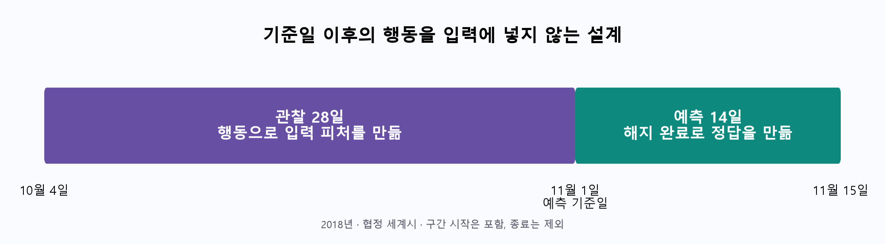

해지 화면 방문과 실제 해지 완료를 구분했습니다. 정답 0은 이 예측 기간 안에서 해지가 확인되지 않았다는 뜻입니다.

---

<a id="section-3"></a>

## 3. 전처리와 탐색 분석

### 전처리에서 내린 판단

| 확인한 문제 | 처리와 이유 |
| --- | --- |
| 비로그인 공통 고객 번호 | 가입 정보 없이 비로그인·방문자 기록만 있는 번호 1261737의 778,479건을 고객 분석에서 제외 |
| 곡 정보 누락 | 재생 이벤트에서는 곡·가수·길이가 모두 존재함을 확인하고 비재생 이벤트의 구조적 누락을 일괄 삭제하지 않음 |
| 가입 시각 모순 | 144명에서 가입 이전 이벤트 11,484건을 확인해 가입 기간 피처를 사용하지 않고 행동 기록은 보존 |
| 큰 값과 0 | 분포만으로 오류라고 볼 근거가 없어 큰 이용량을 임의 삭제하거나 자르지 않음. 행동 0과 음수 변화량은 보존 |
| 최종 고객표 | 자료형·결측·무한대·범위·고객 중복·계산식과 저장 전후 일치를 검사 |

고객 수는 관찰 활동 고객 20,642명에서 기준일 이전 해지자 2,503명을 제외해 18,139명이 됐습니다.

### 입력 피처 구성

| 구분 | 주요 내용 |
| --- | --- |
| 이용 규모 | 활동 일수와 세션 수, 재생 이벤트 수 |
| 최근 이용 변화 | 마지막 활동 이후 경과 일수, 최근 7일과 이전 7일 재생 수, 두 기간의 차이 |
| 만족과 불편 신호 | 좋아요·싫어요·재생목록 추가·광고·오류·도움말 횟수 |
| 이용 등급 | 관찰 기간 마지막 무료·유료 상태 |

정형 입력은 수치형 13개와 범주형 1개입니다. 고객 번호·정답·분할 정보는 모델 입력에서 제외했습니다. 원시 행동 시퀀스는 고객별 마지막 최대 50개 이벤트로 별도 준비했습니다.

학습용 숫자 배열은 [시퀀스 생성 코드](notebooks/시퀸스데이터.ipynb)에서 행동을 정렬한 뒤 번호를 부여하고 길이를 50으로 맞춥니다. 부족한 부분은 뒤쪽에 0을 채웁니다. 기간 적용 전제와 세부 규칙은 [전처리 결과서](docs/01_데이터전처리_결과서.md)에 기록했습니다.

### 탐색 분석에서 확인한 질문

아래는 수행한 탐색을 질문과 관찰로 정리한 것입니다. 통계적 가설 검정이나 사전 등록한 가설의 검증 결과는 아닙니다.

| 질문 | 학습 자료에서 관찰한 결과 | 설계에 주는 시사점 |
|---|---|---|
| 이용이 감소한 고객만 이탈하는가? | 증가 그룹 6.30%, 감소 그룹 5.83% | 이용 변화 하나만으로 대상을 선정하지 않음 |
| 최근까지 활발하면 안전한가? | 마지막 활동 1일 미만 그룹도 이탈 8.76% | 최근 활동과 이용 규모·불편 신호를 함께 확인 |
| 피처는 서로 독립적인가? | 활동 일수와 세션 수의 순위 상관 약 0.975 | 단변량 관계나 모델 계수를 독립적인 원인으로 해석하지 않음 |

학습 고객 12,697명만 대상으로 정답 불균형, 수치 분포, 주요 변수와 이탈의 관계, 피처 간 관련성을 확인했습니다.
[별도 분석 문서](docs/03_탐색적데이터분석.md)와 [실행 결과가 포함된 노트북](notebooks/05_탐색적데이터분석.ipynb)에 그래프 6개와 집계표·해석을 남겼습니다.

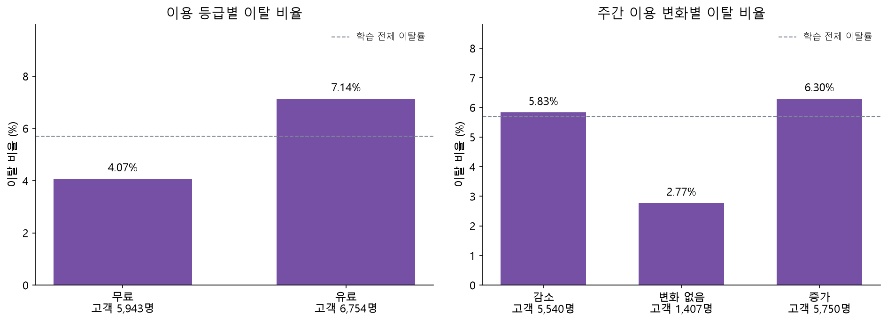

유료 고객 이탈 비율은 7.14%, 무료 고객은 4.07%였습니다. 이용량 증가 그룹도 6.30%로 감소 그룹 5.83%보다 높아, 이용 감소 하나만으로 고객을 선정하기 어렵습니다.

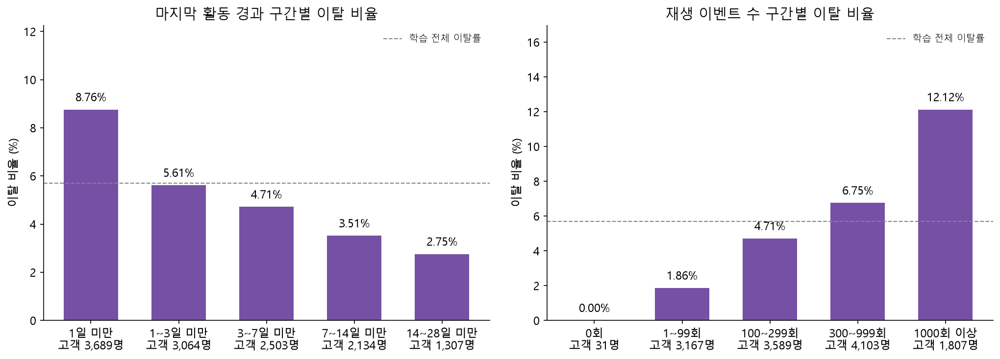

마지막 활동 1일 미만 그룹은 이탈 비율 8.76%, 재생 1,000회 이상 그룹은 12.12%였습니다. 최근까지 활발한 고객도 유지한다고 단정하기 어렵다는 관찰입니다.
이는 학습 자료의 단순한 관련성으로서 원인·효과 또는 다른 시점에서도 보장되는 규칙이 아닙니다.

활동 일수와 세션 수의 순위 상관은 약 0.975였습니다. 관련성이 큰 피처와 재생 수 계산식의 종속을 확인해 계수를 독립적인 원인으로 해석하지 않고, 0·음수 변화량·정상 범위의 큰 값은 보존했습니다.

---

<a id="section-4"></a>

## 4. 학습과 평가

### 공통 분할과 평가 기준

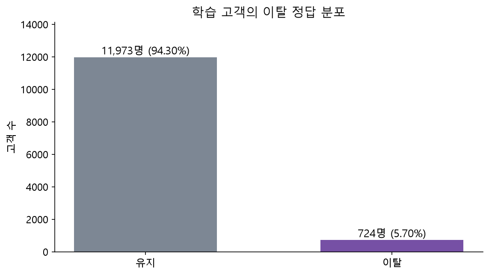

고객별 한 행을 공통 분할표로 나눠 팀원이 같은 고객을 학습·검증에 사용하도록 했습니다.

| 구분 | 고객 수 | 이탈 고객 수 | 이탈 비율 |
| --- | --- | --- | --- |
| 학습 | 12,697 | 724 | 5.70% |
| 검증 | 2,721 | 156 | 5.73% |
| 최종 평가용으로 분리한 자료 | 2,721 | 155 | 5.70% |

- 학습 자료로 모델과 수치 변환 기준을 학습합니다.
- 검증 자료로 후보 설정과 판정 기준을 비교합니다.
- 최종 평가용 자료는 설정을 고정한 뒤 한 번 평가하는 것이 원칙입니다.

이탈 비율이 낮아 정확도만으로 성능을 판단하지 않았습니다. 검증 고객을 모두 유지로 예측해도 정확도는 약 94.27%입니다. 평균정밀도와 수신자 곡선 면적, 정밀도와 재현율을 함께 확인했습니다.

**현재 팀원의 조합 탐색은 최종 평가용 자료를 모델 선택에 사용했습니다. 따라서 해당 자료는 독립적인 최종 평가 자료로 남아 있지 않습니다.**

### 같은 검증 집단에서 비교한 기준 모델

같은 검증 고객 2,721명에서 비교한 개인 실험 세 가지입니다. 모델 설정은 검증 평균정밀도, 판정 기준은 검증 조화평균으로 선택했습니다.

| 모델 | 검증 평균정밀도 | 검증 수신자 곡선 면적 | 정밀도 | 재현율 | 조화평균 |
| --- | --- | --- | --- | --- | --- |
| 로지스틱 회귀 | 0.1701 | 0.7074 | 24.26% | 21.15% | 0.2260 |
| 서포트 벡터 머신 | 0.1658 | 0.7115 | 19.72% | 26.92% | 0.2276 |
| 다층 신경망 | 0.1773 | 0.7053 | 22.29% | 23.72% | 0.2298 |

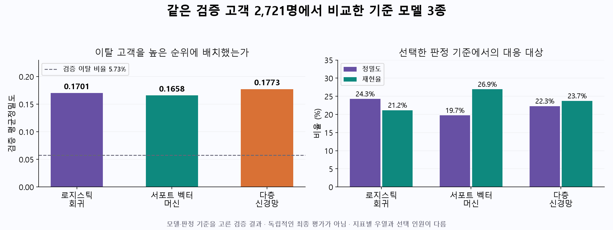

다층 신경망의 평균정밀도가 이 세 실험에서 가장 높았지만, 지표별 우열이 다르고 차이도 작아 확정적인 전체 최우수 모델로 주장하지 않습니다.

### 튜닝과 과적합 점검

- 로지스틱 회귀는 규제 강도와 클래스 가중치를 비교했습니다. 검증 평균정밀도는 약 0.1695에서 0.1701로 소폭 바뀌었습니다.
- 서포트 벡터 머신은 기본 모델의 학습 평균정밀도 0.5152와 검증 0.1038의 큰 차이를 확인했습니다. 규제·커널 범위·균형 가중치를 조정한 뒤 학습 0.1384와 검증 0.1658을 얻었습니다.
- 다층 신경망은 구조·규제·균형 가중치를 비교했습니다. 검증 평균정밀도가 가장 높았던 2회차 가중치를 보존하고, 15회 연속 개선이 없어 17회차에서 종료했습니다.

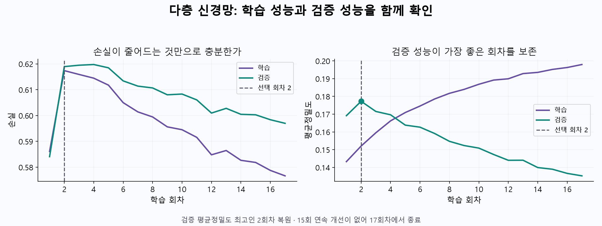

학습 평균정밀도는 계속 상승했지만 검증 평균정밀도는 2회차 이후 하락했습니다. 따라서 마지막 회차 대신 검증 최고 회차를 복원했습니다.

판정 기준 조정은 연락 대상으로 분류하는 인원을 바꾸며, 평균정밀도나 수신자 곡선 면적 자체를 개선하지는 않습니다.

<details>
<summary>팀 확장 실험의 후보 16종과 저장 결과 보기</summary>

정형 입력 13종과 시퀀스 입력 3종입니다. 정형 후보에도 다층 신경망이 포함되므로 모두 비신경망 모델이라고 부르지 않습니다.
아래 수치는 최종 평가용 자료를 탐색에 사용한 참고값으로, 앞의 세 모델 검증 성능과 합쳐 순위를 정하지 않습니다.

| 후보 | 입력 | 저장 수신자 곡선 면적 | 저장 판정 기준 |
| --- | --- | --- | --- |
| 에이다부스트 | 정형 | 0.7292 | 0.337763 |
| 결정 트리 | 정형 | 0.6880 | 0.067890 |
| 엑스트라 트리 | 정형 | 0.7264 | 0.064205 |
| 히스토그램 그래디언트 부스팅 | 정형 | 0.7216 | 0.055802 |
| 최근접 이웃 | 정형 | 0.5990 | 0.200000 |
| 라이트지비엠 | 정형 | 0.7373 | 0.061214 |
| 로지스틱 회귀 | 정형 | 0.7226 | 0.049297 |
| 정형 다층 신경망 | 정형 | 0.5882 | 0.029583 |
| 나이브 베이즈 | 정형 | 0.6966 | 0.000607 |
| 랜덤 포레스트 | 정형 | 0.7259 | 0.060549 |
| 서포트 벡터 머신 | 정형 | 0.4927 | 0.034101 |
| 엑스지부스트 | 정형 | 0.7331 | 0.058718 |
| 캐트부스트 | 정형 | 0.7337 | 0.082539 |
| 일차원 합성곱 신경망 | 시퀀스 | 0.8453 | 0.383324 |
| 장단기 기억 신경망 | 시퀀스 | 0.8685 | 0.505169 |
| 트랜스포머 | 시퀀스 | 0.8631 | 0.415613 |

</details>

---

<a id="section-5"></a>

## 5. 모델 조합 탐색 구현과 서비스 적용

### 모델 조합 탐색 코드를 구현한 이유

모델 하나를 정해 적용하는 데서 끝내지 않고, **저장된 정형 모델과 시퀀스 신경망의 조합·비중을 비교하고 선택 결과를 저장하는 탐색 코드**를 구현했습니다.

| 단계 | 코드가 수행하는 일 | 선택 근거 또는 산출물 |
|---|---|---|
| 후보 수집 | 모델 폴더에서 지원하는 파일을 찾고 각 모델의 예측값을 수집 | 탐색 실행 당시 정형 입력 13종·시퀀스 입력 3종 |
| 조합 비교 | 두 계열의 모델 쌍마다 정형 출력 비중 0.50~0.95를 0.05 간격으로 비교 | 13 × 3 × 10 = 390개 후보 조합 |
| 조합 선택 | 결합 출력의 수신자 곡선 면적을 비교하고 최고값을 갱신 | 탐색 범위와 사용 자료 안에서 선택한 모델 쌍과 비중 |
| 판정 기준 선택 | 선택된 결합 출력에서 재현율을 더 중시하는 조화평균으로 기준 탐색 | 재현율 가중치 2를 적용한 판정 기준 |
| 결과 저장 | 모델 이름·비중·성능·판정 기준과 결합 예측 배열을 저장 | 설정 파일과 예측 배열 |
| 서비스 연결 | 확인한 설정과 모델을 앱에 연결하고 저장 예측을 재현 | 앱은 새 탐색 없이 저장된 조합으로 추론 |

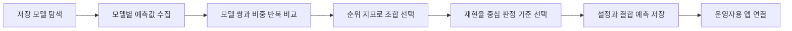

이는 **탐색 절차의 코드화와 결과 저장·서비스 연결**이라는 개발 성과입니다. 모든 모델·모든 비중을 대상으로 한 전역 최적화나 새로운 고객에 대한 최적 성능을 증명한 것은 아닙니다. 조합 선정은 수신자 곡선 면적, 판정 기준 선정은 재현율 중심 조화평균으로 기준을 구분했습니다.

[탐색 구현 노트북](notebooks/최적_모델_탐색.ipynb) · [앱 적용 설정](model/best_hybrid_config.json) · [학습 결과서](docs/02_학습_결과서.md)

### 탐색 결과의 서비스 적용

팀원의 확장 실험은 정형 입력 모델 13종과 시퀀스 신경망 3종을 포함합니다. 저장된 탐색 결과에서 선택한 다음 조합을 앱에 연결했습니다.

**에이다부스트 출력 60%와 장단기 기억 신경망 출력 40%를 결합합니다. 저장된 판정 기준은 0.39822677201244505입니다.**

앱에서는 결합 출력에 100을 곱하므로 약 39.822677점을 기준으로 표시합니다. 실제 해지율로 보정된 확률을 뜻하지는 않습니다.

| 구분 | 현재 확인한 내용 |
| --- | --- |
| 검증 연결 점검 | 평균정밀도 0.2968, 수신자 곡선 면적 0.8989 |
| 저장 판정 기준의 검증 결과 | 정밀도 20.78%, 재현율 85.26%, 대상 640명 중 실제 해지 133명 |
| 최종 평가용 자료를 사용한 탐색 참고값 | 수신자 곡선 면적 0.8994. 독립적인 최종 성능으로 해석할 수 없음 |
| 입력 연결 확인 | 제공된 배열로 재현한 정형·신경망·조합 예측이 팀원의 저장 예측과 일치 |

행동 배열 생성 코드에서 숫자 부여·최근 50개 선택·뒤쪽 0 채우기 규칙을 확인했습니다. 입력 자료의 관찰 기간 제한은 팀의 전제로 적용했으며 원본 날짜 범위의 재검사는 수행하지 않았습니다. 이 조합과 앞의 정형 기준 모델은 입력과 선정 절차가 달라 결합만의 개선 효과로 단정할 수 없습니다.

---

<a id="section-6"></a>

## 6. 서비스 구현

| 순서 | 운영자가 하는 일 |
|---|---|
| 고객 선정 | 홈의 관리 목록에서 점수 구간·판정 기준·관리 인원·예산으로 고객을 확인 |
| 구간별 대응 | 요금제로 걸러 위험 구간별 고객 수와 제안 혜택을 확인하고 알림 모의 실행 |
| 고객 확인 | 고객 상세에서 위험 신호와 추천 대응을 살펴 실제 불편을 확인 |
| 대응 계획 | 캠페인에서 비용과 가정한 성공률을 입력해 연락 인원과 예상 이익을 비교 |
| 결과 기록 | 홈의 대응 결과 확인에서 실제 대응군·비교군의 같은 14일 결과를 수동 입력 |

### 실제 화면으로 보는 운영 흐름

팀에서 촬영한 시연 영상의 실제 화면입니다. 아래 화면을 클릭하면 해당 전체 영상 파일을 열 수 있습니다. 앱을 실행할 수 없는 발표 환경에서는 [마지막 시연 영상](#section-10)을 사용합니다.

**① 관리 목록 — 운영 기준과 고객 선정 방식을 확인합니다.**

[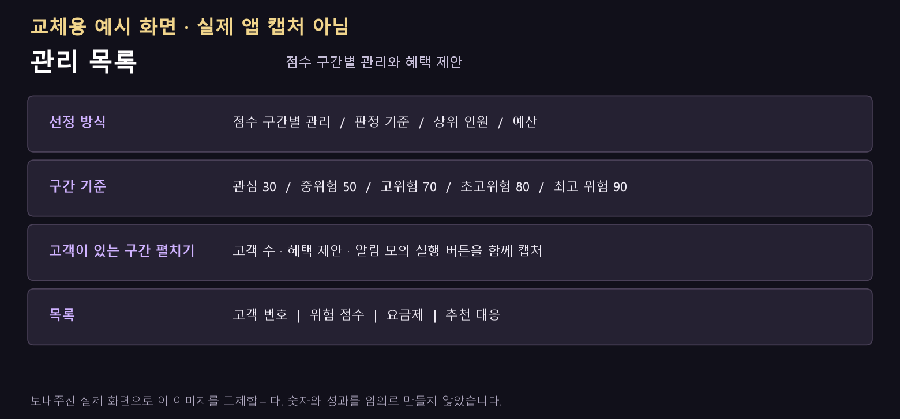](assets/demo/01_home.mp4)

**② 고객 상세 — 위험 점수와 확인 신호, 추천 대응을 살펴봅니다.**

[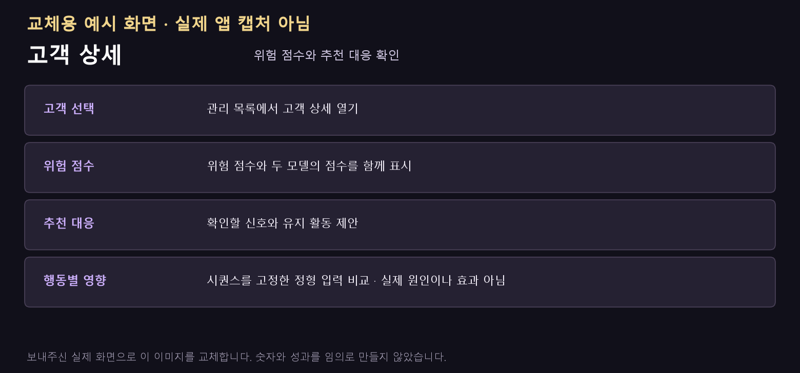](assets/demo/02_customer.mp4)

<details>
<summary>캠페인·고객 자료·설정 화면 보기</summary>

**캠페인:** 입력 비용과 가정한 성공률에 따른 예상 손익입니다. 실제 캠페인 성과가 아닙니다.

[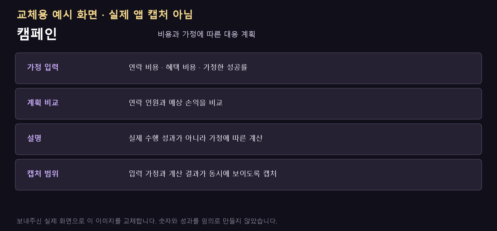](assets/demo/03_campaign.mp4)

**고객 자료:** 같은 기준일의 정형 고객표와 신경망 입력을 등록하고 관리합니다.

[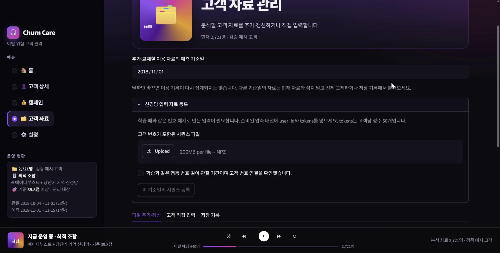](assets/demo/04_data.mp4)

**설정과 분석 자료:** 저장된 최적 조합의 연결 상태와 상세 설정을 확인합니다.

[](assets/demo/05_settings.mp4)

</details>

<details>
<summary>점수 구간과 혜택 예시·모의 실행 범위 보기</summary>

### 추가한 점수 구간별 관리

| 기본 구간 | 화면의 혜택 제안 예시 |
|---|---|
| 90점 이상 100점 이하 · 최고 위험군 | 1개월 무료 또는 3개월간 월 990원 |
| 80점 이상 90점 미만 · 초고위험군 | 3개월 연속 50% 할인 또는 1개월 무료 연장 |
| 70점 이상 80점 미만 · 고위험군 | 2~3개월간 30~40% 할인과 맞춤 재생목록 |
| 50점 이상 70점 미만 · 중위험군 | 1~2개월간 15~20% 할인 쿠폰 또는 포인트 |
| 30점 이상 50점 미만 · 관심군 | 다운로드·고음질·제휴 콘텐츠 이용 혜택 |
| 0점 이상 30점 미만 · 저위험군 | 일반 멤버십 유지, 구간별 알림 모의 실행 대상 제외 |

구간 경계 다섯 개는 화면에서 조정할 수 있습니다. 기본값 30·50·70·80·90점과 70점 이상 우선 관리 안내, 할인 내용은 **운영 시나리오 예시**이며 성능·비용·효과를 검증해 선정한 정책이 아닙니다. 모델의 이탈 판정 기준 약 39.8점과 구간별 대응 기준은 별개입니다.

구간별 알림 버튼은 해당 구간의 고객 수와 안내 문구를 화면에 표시하는 **모의 실행**입니다. 실제 문자·앱 알림·이메일을 발송하거나 발송 이력을 저장하지 않습니다. 구간 관리 모드의 아래쪽 선택 고객 수와 내려받기 목록에는 요금제로 필터한 저위험군도 포함되므로, 이를 실제 발송 인원으로 설명하지 않습니다.

</details>

캠페인 결과는 아직 수집하지 않았습니다. 실제 이탈 감소나 매출 증가를 달성했다고 주장하지 않습니다. 고객별 행동 영향은 시퀀스를 고정한 정형 입력 변경 비교이며 신경망 행동 중요도나 실제 대응 효과가 아닙니다.

실제 기능은 앱 시연으로 확인할 수 있습니다. 메뉴 표시 방식도 수정했으며, 모델·전처리·학습 자료와 저장된 판정 기준은 변경하지 않았습니다.

---

<a id="section-7"></a>

## 7. 구조와 실행

### 학습과 서비스의 연결 구조

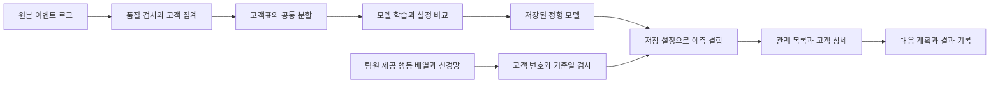

행동 배열 생성 코드는 별도 노트북으로 제공합니다. 앱은 준비된 배열을 사용하며 신규 원시 로그를 자동 변환하는 기능은 연결하지 않았습니다.

| 기능 | 주요 파일 | 역할 |
|---|---|---|
| 화면 | `service/app.py`, `service/ui.py` | 메뉴·표·입력·공통 디자인 |
| 모델 추론 | `service/core.py`, `models.py` | 모델 불러오기·결합 점수·고객별 입력 비교 |
| 시퀀스 연결 | `service/sequence_runtime.py` | 고객 번호·기준일·숫자 배열 검사 |
| 자료 검사와 보관 | `service/validation.py`, `service/storage.py` | 자료형·계산식 확인과 고객표 수정 이력 |
| 대응 결과 | `service/operating_views.py`, `service/operations.py` | 대응군·비교군 입력과 계산·저장 |

### 사용 기술과 실행

| 영역 | 사용 기술 |
|---|---|
| 데이터 처리와 시각화 | 파이썬, 판다스, 넘파이, 맷플롯립 |
| 모델 학습과 추론 | 사이킷런, 파이토치, 트리 기반 분류 라이브러리 |
| 운영 화면 | 스트림릿, 플로틀리 |
| 운영 기록 | 고객표 파일, 제이슨 기록, 에스큐엘라이트 |

파이썬 3.12 환경에서 필요한 패키지를 설치한 뒤 저장소 최상위에서 실행합니다.

```powershell
python -m pip install -r requirements.txt
python -m streamlit run service/app.py
```

파이썬 3.12 환경의 저장소 최상위에서 실행합니다. 앱 시작 시 모델을 다시 학습하지 않습니다. 실행 중 생긴 고객·대응 기록과 12기가바이트 원본은 배포본에 포함하지 않습니다.

---

<a id="section-8"></a>

## 8. 결과와 한계

### 이번에 완성한 범위

| 목표 | 확인한 산출물 |
|---|---|
| 학습 가능한 고객표 준비 | 18,139명·입력 피처 14개, 고객 중복 없는 공통 분할 |
| 데이터의 특성과 처리 이유 설명 | 학습 자료 대상 탐색 그래프 6개, 누락·시간 정합성 검사 기록 |
| 머신러닝과 신경망 비교 | 기준 모델 3종의 검증 비교와 팀 확장 후보 기록 |
| 조합 탐색 코드 구현 | 후보 모델·비중 390개 비교, 판정 기준 선택, 설정·예측 저장, 앱 연결 |
| 운영에 활용 | 관리 목록·고객 상세·대응 계획·결과 기록 화면, 기능 검사 20개 통과 |

### 아직 주장할 수 없는 것

| 항목 | 현재 한계와 다음 확인 |
|---|---|
| 독립적인 최종 성능 | 최종 평가용 자료를 조합 선택에 사용함. 미사용 시점 자료가 필요 |
| 시퀀스 입력의 검토 범위 | 생성 규칙과 저장 예측 재현 확인. 입력 기간 제한은 팀의 전제이며 원본 날짜 재검사·배열 전체 재생성 비교는 미수행 |
| 실제 이탈 감소와 수익 증가 | 실제 캠페인 미수집. 같은 기간의 대응군·비교군 결과로 이후 확인 |
| 최적의 할인 정책 | 구간·할인율은 운영 예시. 비용과 효과를 비교한 정책 최적화 결과가 아님 |


---

<a id="section-9"></a>

## 9. 제출 산출물과 평가 근거

| 평가 항목 | 제출 자료 |
|---|---|
| 데이터 특성·주요 변수 관계 | [탐색적 데이터 분석](docs/03_탐색적데이터분석.md), [실행 노트북](notebooks/05_탐색적데이터분석.ipynb) |
| 결측·이상값·인코딩·스케일링·분할 | [데이터 전처리 결과서](docs/01_데이터전처리_결과서.md), [전처리 노트북](notebooks/01_데이터검증_및_전처리.ipynb) |
| 모델 비교·과적합·설정 조정·지표 | [학습 결과서](docs/02_학습_결과서.md) |
| 모델 조합 탐색 코드 구현 | [탐색 노트북](notebooks/최적_모델_탐색.ipynb), [저장한 적용 설정](model/best_hybrid_config.json) |
| 학습된 모델 | `model/`, 신경망 구조 `models.py` |
| 기능별 모듈화와 앱 시연 | `service/`, 7절 실행 방법 |

### 제출 폴더 구성

```text
저장소 최상위/
├── README.md                 발표 자료와 실행 방법
├── docs/                     전처리·학습 결과서, 탐색 분석, 수치 근거
├── notebooks/                전처리·분석·모델링·조합 탐색 코드
├── model/                    앱에서 사용하는 모델과 조합 설정
├── models.py                 신경망 구조
├── service/                  앱·추론·입력 검사·기록 저장 코드
├── data/processed/           앱 실행과 분석에 필요한 처리 자료
├── assets/                   발표 그래프와 화면 설명 이미지
├── requirements.txt          앱 실행 패키지 목록
├── requirements_eda.txt      탐색 분석용 추가 패키지 목록
├── .streamlit/               화면 설정
└── .gitignore                실행 기록과 원본 데이터 제외 규칙
```

앱 실행에는 포함된 자료와 모델을 사용합니다. 원본 로그와 실제 운영 기록은 포함하지 않습니다. 탐색 노트북은 당시 실험 기록으로, 390개 후보 전체 재실행에는 당시 후보 모델 전체와 같은 입력 변환 자료 및 경로 설정이 추가로 필요합니다. 현재 모델 묶음은 앱 추론용이며 전체 후보 학습 산출물과 같지 않습니다.

<a id="section-10"></a>

## 10. 앱 시연 영상

다른 컴퓨터에서 앱을 실행하지 않아도 녹화된 기능을 확인할 수 있습니다.

**[전체 시연 영상 파일 내려받기](https://raw.githubusercontent.com/SKNETWORKS-FAMILY-AICAMP/SKN37-2ST-4TEAM/main/assets/demo/00_full_demo.mp4)** · 약 2분 28초 · 관리 목록 → 고객 상세 → 캠페인 → 고객 자료 → 설정 순서

아래 움직이는 이미지는 각 영상의 일부를 보여주는 짧은 미리보기입니다. 소리는 없으며, 전체 길이와 녹화된 소리는 영상 파일에 포함됩니다. 전체 영상은 내려받아 재생합니다.

### 관리 목록 미리보기

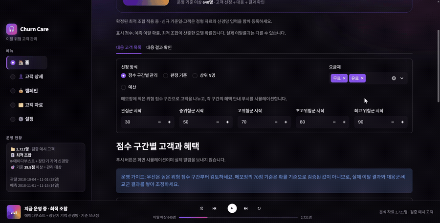

<details>
<summary>고객 상세·캠페인·고객 자료·설정 미리보기 펼치기</summary>

**고객 상세**

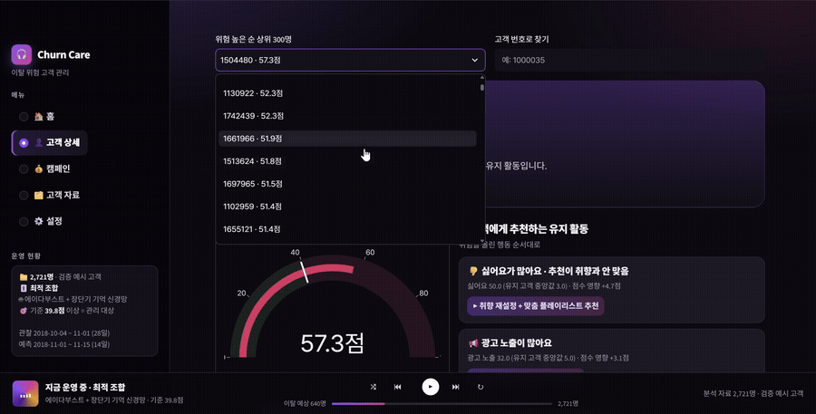

**캠페인**

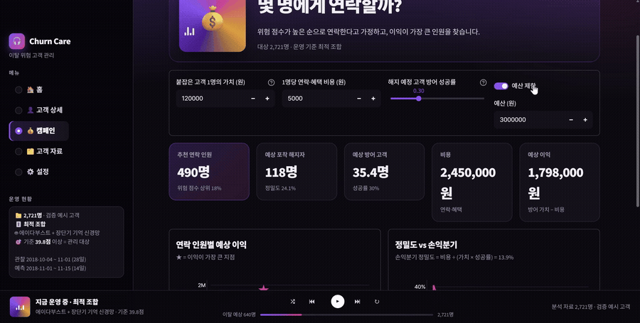

**고객 자료**

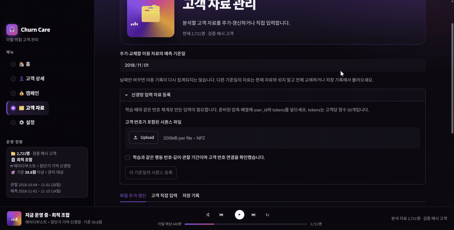

**설정과 분석 자료**

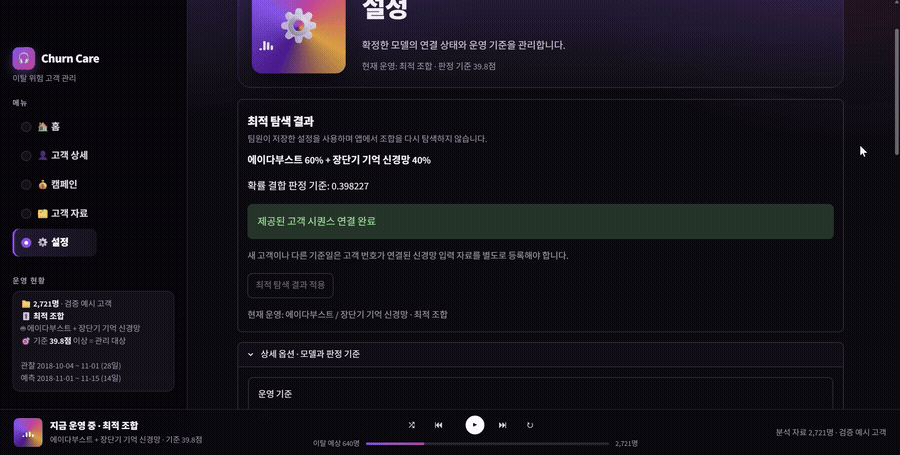

</details>

| 개별 시연 영상 | 길이 | 영상 파일 |
|---|---|---|
| 관리 목록 | 약 24초 | [내려받기](https://raw.githubusercontent.com/SKNETWORKS-FAMILY-AICAMP/SKN37-2ST-4TEAM/main/assets/demo/01_home.mp4) |
| 고객 상세 | 약 35초 | [내려받기](https://raw.githubusercontent.com/SKNETWORKS-FAMILY-AICAMP/SKN37-2ST-4TEAM/main/assets/demo/02_customer.mp4) |
| 캠페인 계획 | 약 37초 | [내려받기](https://raw.githubusercontent.com/SKNETWORKS-FAMILY-AICAMP/SKN37-2ST-4TEAM/main/assets/demo/03_campaign.mp4) |
| 고객 자료 | 약 31초 | [내려받기](https://raw.githubusercontent.com/SKNETWORKS-FAMILY-AICAMP/SKN37-2ST-4TEAM/main/assets/demo/04_data.mp4) |
| 설정과 분석 자료 | 약 21초 | [내려받기](https://raw.githubusercontent.com/SKNETWORKS-FAMILY-AICAMP/SKN37-2ST-4TEAM/main/assets/demo/05_settings.mp4) |

시연은 예측·고객 선정·대응 계획 기능의 동작을 보여줍니다. 실제 알림 발송이나 이탈 감소 성과를 뜻하지 않습니다.

## 13 팀원별 프로젝트 회고


> **이재현**
> 이번에 개인적으로 욕심을 부려서 조금이라도 난이도 있는 프로젝트를 하고 싶었습니다. 다만 구할 수 있는 데이터가 12.76GB 정도였고, 분석해본 결과 많이 쳐줘도 최근 50개 정도, 실질적으로는 최근 5개 정도의 행동만으로 딥러닝을 하는 결과를 보였습니다. 이 점을 고려하여 유저가 방문한 마지막 페이지를 정형 데이터 피처로 입력하여 머신러닝을 하면 딥러닝과 블렌딩하는 것보다 더 성능이 높게 나왔습니다.
> 
> 이러한 점을 보았을 때 딥러닝은 데이터 규모가 정말 어마어마하게 커야 하고, 시간을 많이 투자해야 한다는 점을 느꼈으며, 이 정도의 데이터는 피처 엔지니어링과 머신러닝으로 충분히 커버 가능하다는 점, 그리고 딥러닝이 강세라고는 하지만 머신러닝도 특정 분야에서는 강점을 가진다는 점을 느꼈습니다.
> 
> 힘들었던 점 및 트러블슈팅:
> 1. 데이터가 커서 기존에 배웠던 방법으로 처리가 안 되어 방법을 찾아내고 적용하는 게 힘들었습니다.
> 2. 모델링을 각자 해서 모은 모델들 중 최적의 조합을 찾아서 블렌딩하였는데, 딥러닝은 혼자 담당해서 괜찮았지만 머신러닝 모델들은 이상하게 안 맞아서 그걸 수정하는 것이 힘들었습니다. 대표적으로 CatBoost는 혼자 저장 형식이 `.cbm`이라서 처리하기 귀찮았습니다.
> 3. 알고는 있었지만 작업 시작 전 확실하게 정해두고 시작해야 한다는 점을 좀 더 크게 느꼈습니다. 초반에 데이터 전처리한 것을 바꿨었는데, 바꾸고 나서 딥러닝 성능이 급감하거나 데이터가 안 맞는 등 문제가 발생해서 이를 처리해내는 것이 다소 힘들었습니다.
> 4. 피처 엔지니어링이 다소 까다로웠습니다. 데이터 성격상 이탈 고객의 범주를 우리가 정하는 것이 아닌 데이터에서 이탈 여부를 파악할 수 있지만 그걸 처리하는 것이 까다로웠습니다. 이를 잘못 처리해서 딥러닝과 머신러닝 테스트 데이터로 답을 100% 맞추는 기염을 토했으나, 다행히 데이터 누수(Data Leakage)되는 부분을 찾아 수정한 후 정상 범주로 돌아오는 경험을 하였습니다.

> **서민석**
> 1. 배운 점 및 성장한 부분
> - 데이터 전처리의 중요성 재발견: 단순한 불필요 컬럼 제거(drop) 수준을 넘어, 데이터 특성에 맞춰 맞춤형 전처리를 진행할 때 학습 효율과 정확도가 크게 상승하고 학습 시간도 단축됨을 확인했습니다.
> - 다양한 모델의 실전 적용 및 앙상블 활용: 이론으로 배운 k-NN, Naive Bayes 등 머신러닝 알고리즘과 LSTM, GNN 등 딥러닝 모델을 직접 구현했습니다. 머신러닝과 딥러닝의 장점을 결합한 앙상블 기법을 적용하여 모델 간 단점을 보완하고 예측 성능을 개선했습니다.
> 
> 2. 트러블슈팅 (문제 해결 경험)
> - 문제 상황: 초기에 대용량 데이터로 정확도, 재현율, F2-Score 등을 확보했으나, 프로젝트 취지에 맞게 데이터를 압축/정제하면서 데이터 수가 줄어들어 모델 성능이 하락하는 어려움을 겪었습니다.
> - 해결 방안: 데이터 재분할 전략을 도입하고, 데이터 특성에 맞는 새로운 모델을 도입 및 튜닝하여 성능을 다시 끌어올렸습니다.

> **김신형**
> 이번 프로젝트에서 나는 그래디언트 부스팅 모델링, 이탈 관리 서비스(Streamlit) 제작을 맡았다.
> 
> 가장 크게 배운 건 "좋은 점수"와 "쓸 수 있는 결과"가 다르다는 점이다. 이탈 고객이 5.7%뿐이라 모든 고객을 유지로 찍어도 정확도가 94%가 나온다. 그래서 재현율과 정밀도, 그리고 관리할 수 있는 인원 안에서 실제 이탈자를 몇 명 찾는지를 기준으로 삼았다. XGBoost, LightGBM, CatBoost는 ROC-AUC 0.74 근처로 큰 차이가 없었고, 오히려 그 점수를 운영자가 이해하고 바로 쓸 수 있게 만드는 일(위험 점수, 판정 기준, 캠페인 손익 계산, 대응 효과 확인)에 더 많은 고민이 들어갔다.
> 
> 어려웠던 점 및 트러블슈팅:
> - 점수 눈금 맞추기: 모델마다 확률 크기가 달라 머신러닝과 신경망 점수를 그대로 섞을 수 없었다. 검증 고객 안에서의 순위로 바꾼 0~100점 위험 점수를 만들어 해결했다.
> - GitHub 협업: 웹 업로드에 의존하다 보니 `.streamlit`, `.gitignore`처럼 점으로 시작하는 파일이 빠지거나, 실행에 필요한 파일이 빠져 일일이 수기로 입력해야 하는 상황이 발생했었다.
> - 마지막 통합: 최종 통합 앱의 수정이 너무 여러 사람이 진행되어 내가 수정한 내용이 다른 사람에 의해 덮어쓰기 되어버리는 바람에 다시 작업을 해야하는 경우가 여러번 있었다.

> **염진일**
> 이번 프로젝트를 통해 AI 기술이 가져오는 혁신과 영향력을 새삼 실감하였으며, 향후 AI를 효과적으로 다루고 활용하는 역량이 핵심 경쟁력이 될 것임을 깨달았다. 실제 앱 테스트와 문서 검토 과정을 거치며 이론으로만 배웠던 머신러닝과 딥러닝의 개념을 깊이 있게 체득할 수 있었다. 이번에 쌓은 실무적 감각을 바탕으로, 앞으로 AI를 적극적으로 융합하도록 해야 할 것이다.
