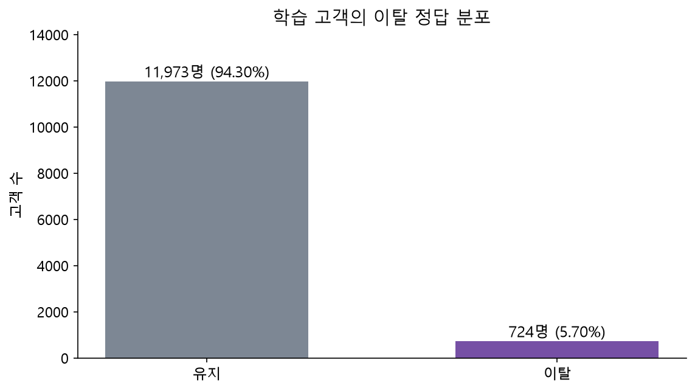
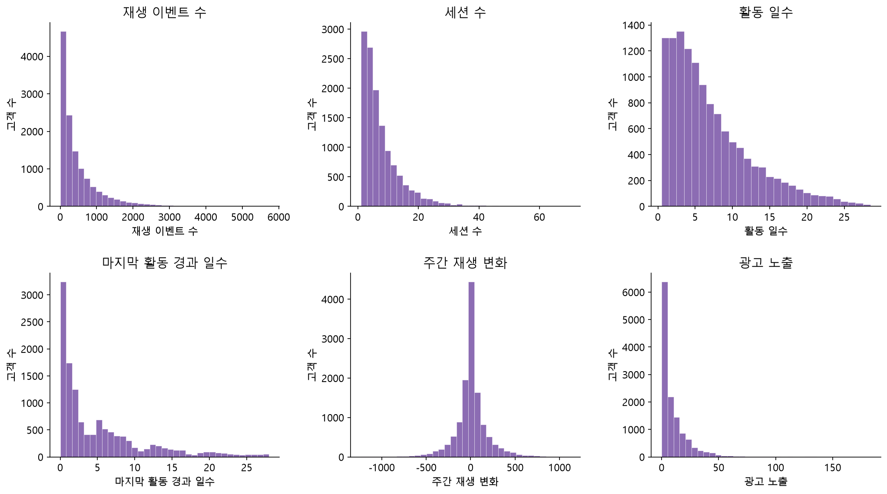
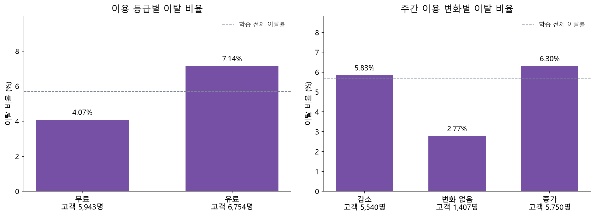
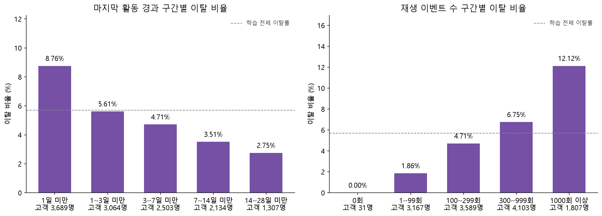
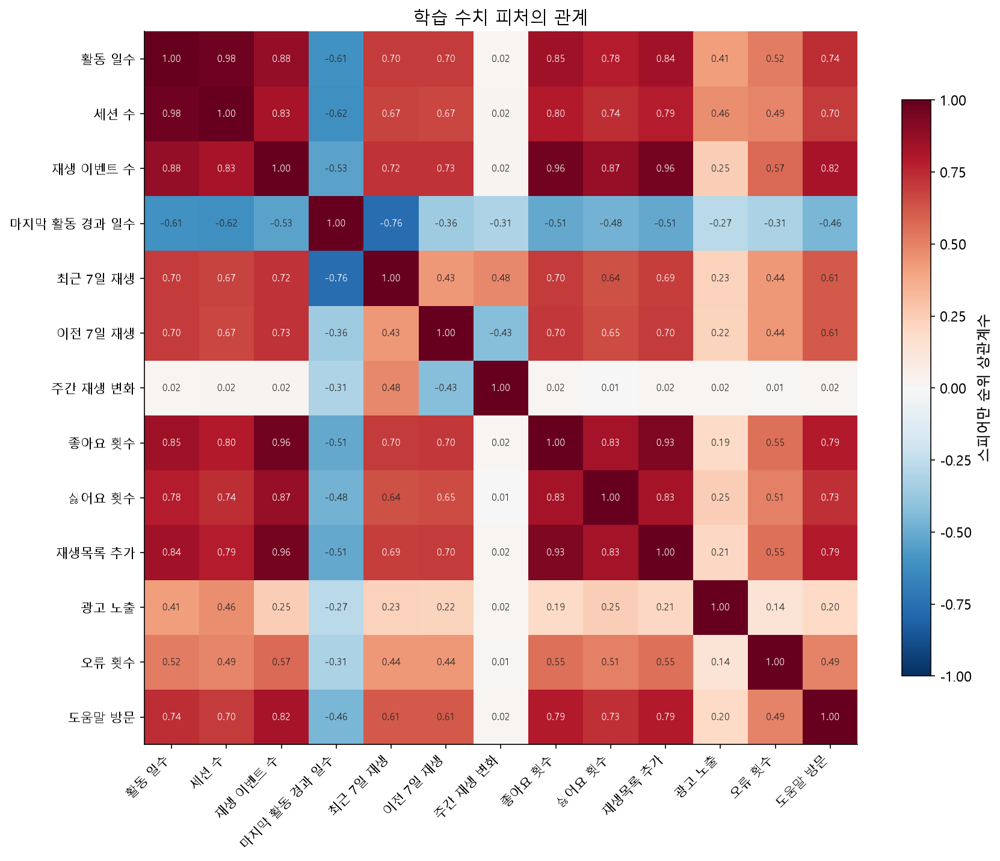
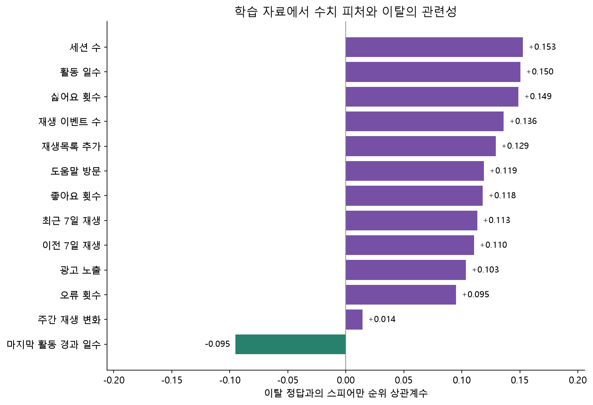

# 탐색적 데이터 분석

분석 기준은 공통 고객표의 학습 고객 12,697명입니다. 모델이나 전처리 규칙을 새로 맞추지 않고 분포와 관계를 확인했습니다.
검증·최종 평가 자료의 관계를 추가로 탐색하지 않았으며 원본이나 고객표를 변경하지 않았습니다.

## 1 입력 품질과 분석 범위

학습 고객 중복과 결측은 각각 0건이며 수치형 무한대가 없습니다. 수치형 13개와 무료·유료 1개를 대상으로 합니다.
최근 재생 수에서 이전 재생 수를 뺀 값이 주간 변화량과 일치하고, 두 주의 재생 합은 전체 관찰 재생 수를 넘지 않습니다.
이 검사는 집계 고객표 대상이며 대용량 원본의 구조 검사는 [전처리 결과서](01_데이터전처리_결과서.md)에 기록했습니다.

## 2 정답 분포

이탈은 724명으로 5.70%입니다. 전체 고객표의 5.71%와 분모가 다릅니다.
모두 유지로 예측하는 학습 정확도도 94.30%이므로 정확도만으로 학습 성능을 평가하지 않습니다.

## 3 수치형 분포와 처리 선택

재생 수 중앙값은 267회, 최댓값은 5,731회로 오른쪽 꼬리가 깁니다.
오류 횟수 0의 비율은 64.85%, 최근 7일 재생 수 0은 27.86%입니다.
큰 이용량은 오류라는 근거가 없어 삭제·잘라내기를 하지 않았습니다. 0과 음수 변화량도 행동의 의미를 보존합니다.
수치형 표준화는 필요한 모델의 학습 단계에서 학습 자료 기준으로 수행합니다.

## 4 이용 등급과 주간 이용 변화

| 이용 등급 | 고객수 | 이탈수 | 이탈률 |
| --- | --- | --- | --- |
| 무료 | 5943 | 242 | 4.07% |
| 유료 | 6754 | 482 | 7.14% |

| 주간 이용 변화 | 고객수 | 이탈수 | 이탈률 |
| --- | --- | --- | --- |
| 감소 | 5540 | 323 | 5.83% |
| 변화 없음 | 1407 | 39 | 2.77% |
| 증가 | 5750 | 362 | 6.30% |

학습 자료에서는 유료 고객과 이용량 증가 그룹의 이탈 비율도 높았습니다. 이용 감소 하나로 고객을 선정하기 어렵다는 관찰입니다.
요금제와 이용량의 인과 효과를 증명한 결과는 아닙니다. 여러 행동 신호를 함께 모델에 반영할 근거로 사용합니다.

## 5 마지막 활동과 재생 규모

| 마지막 활동 구간 | 고객수 | 이탈수 | 이탈률 |
| --- | --- | --- | --- |
| 1일 미만 | 3689 | 323 | 8.76% |
| 1~3일 미만 | 3064 | 172 | 5.61% |
| 3~7일 미만 | 2503 | 118 | 4.71% |
| 7~14일 미만 | 2134 | 75 | 3.51% |
| 14~28일 미만 | 1307 | 36 | 2.75% |

| 재생 규모 구간 | 고객수 | 이탈수 | 이탈률 |
| --- | --- | --- | --- |
| 0회 | 31 | 0 | 0.00% |
| 1~99회 | 3167 | 59 | 1.86% |
| 100~299회 | 3589 | 169 | 4.71% |
| 300~999회 | 4103 | 277 | 6.75% |
| 1000회 이상 | 1807 | 219 | 12.12% |

학습 자료에서는 마지막 활동 1일 미만 그룹이 8.76%, 14~28일 미만 그룹이 2.75%였습니다.
재생 1,000회 이상 그룹은 12.12%로, 최근까지 활발한 고객도 항상 유지한다고 단정하기 어렵습니다.
재생 0회 구간은 고객 31명과 이탈 0명으로, 작은 표본의 0%를 안전한 집단이라는 근거로 사용하지 않습니다.
구간은 설명을 위한 고정 구간이며 성능을 최대화하도록 선택하지 않았습니다. 고객 수와 이탈 수를 함께 봅니다.
시각적으로 높은 구간이 있어도 운영 규칙이나 해지 원인으로 바로 확정하지 않습니다.

## 6 피처 사이의 관계

| 피처 1 | 피처 2 | 순위 상관계수 |
| --- | --- | --- |
| 활동 일수 | 세션 수 | 0.975 |
| 재생 이벤트 수 | 좋아요 횟수 | 0.965 |
| 재생 이벤트 수 | 재생목록 추가 | 0.956 |
| 좋아요 횟수 | 재생목록 추가 | 0.931 |
| 활동 일수 | 재생 이벤트 수 | 0.879 |

활동 일수와 세션 수의 순위 상관은 약 0.975, 재생 이벤트 수와 좋아요 횟수는 약 0.965입니다.
이용량 피처 사이의 높은 관련성과 함께 최근·이전 재생 및 변화량의 계산식상 종속을 확인했습니다.
관련 피처를 모두 사용할 때 로지스틱 회귀 계수를 서로 독립적인 원인으로 해석하지 않습니다. 관련 피처를 제거한 비교 실험은 추가 검증 과제입니다.

## 7 피처와 이탈 정답의 관계

이 그림은 학습 자료의 단변량 관련성이며 모델 중요도가 아닙니다. 다른 피처를 통제하거나 인과 효과를 추정한 분석도 아닙니다.
좋아요 횟수와 이탈의 단순 순위 상관은 약 +0.118입니다. 개인 로지스틱 회귀에서 좋아요 계수가 음수였던 것과 단순 비교하지 않습니다.
전체 이용량과의 강한 관련성과 다른 피처의 통제 여부, 공선성 때문에 단변량 관련성과 모델 계수의 방향이 다를 수 있습니다. 어느 쪽도 인과 효과는 아닙니다.
상관이 작아도 비선형 관계나 다른 피처와의 결합 효과가 있을 수 있으므로 이 값만으로 제거하지 않습니다.

## 8 재현과 평가 항목 연결

- [실행 결과가 포함된 탐색 분석 노트북](../notebooks/05_탐색적데이터분석.ipynb)
- [수치 근거](evidence/탐색분석_수치.json)
- [분포 표](evidence/탐색분석_수치분포.csv)

분석은 정답 분포, 수치 분포, 주요 변수와 정답의 관계, 피처 간 관련성, 입력 품질을 포함합니다.
관찰 결과를 수치 보존·평가 지표·계수 해석과 연결했으며, 단순한 그래프 나열이나 모델 학습 결과와 구분했습니다.
원시 로그와 신경망 숫자 배열의 생성 규칙 검증은 이 정형 자료 탐색으로 대체하지 않습니다.
